# MorphiX — FastArrayList performance report

**Baseline: 14 November 2026** · `org.morphix.lang.collections.FastArrayList`

## Executive summary

Direct-array construction and bulk insertion are approximately 2.35–2.36× faster at 100,000 elements, with approximately half the allocation. Collection construction and traversal are comparable. Individual append is slower by about 0.47 ns per element in the original run. Retain the original append implementation and prioritize array-native bulk operations.

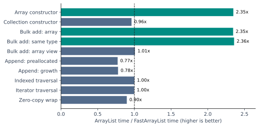

## Methodology

JMH average time (ns/op), 15 samples per benchmark/size; sizes 10, 100, 1,000, 10,000 and 100,000. The benchmark design uses 3 forks, 5 warmup and 5 measurement iterations of one second each, with the GC profiler. The supplied table confirms sample counts but not all environment settings. Inputs are preboxed Integer arrays. Construction and insertion return new lists; traversal sums all elements. Append includes allocation; growth includes resizing. Wrap measures wrapper creation only.

Benchmark class: `org.morphix.benchmark.FastArrayListBenchmark` in `src/test/java`. Run with Maven test compilation and forked JMH.

```bash
mvn clean test-compile exec:exec \
    -Dexec.executable=java \
    -Dexec.classpathScope=test \
    -Dexec.args="-cp %classpath org.openjdk.jmh.Main FastArrayListBenchmark -prof gc"
```

## Baseline at 100,000 elements

| Operation | JDK ns/op | FastArrayList ns/op | JDK / Fast |
|---|---:|---:|---:|
| Array constructor | 26,914.452 | 11,460.451 | 2.35× |
| Collection constructor | 11,016.959 | 11,464.594 | 0.96× |
| Bulk add: array | 26,775.096 | 11,414.695 | 2.35× |
| Bulk add: same type | 26,762.009 | 11,346.213 | 2.36× |
| Bulk add: array view | 26,956.367 | 26,749.827 | 1.01× |
| Append: preallocated | 157,824.367 | 204,566.567 | 0.77× |
| Append: growth | 187,530.536 | 241,344.722 | 0.78× |
| Indexed traversal | 54,268.364 | 54,262.427 | 1.00× |
| Iterator traversal | 54,350.319 | 54,477.304 | 1.00× |
| Zero-copy wrap | 1.126 | 1.256 | 0.90× |

Lower latency is better. Ratios above 1 favor FastArrayList. Wrap compares against Arrays.asList, not ArrayList. The original 100-element JDK array constructor and 1,000-element indexed traversal have unusually large reported errors.

## Array constructor

Direct construction avoids the intermediate collection conversion and extra copy.

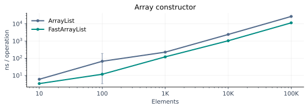

| Elements | JDK ns/op ± error | FastArrayList ns/op ± error | Speedup |
|---:|---:|---:|---:|
| 10 | 6.011 ± 0.059 | 3.376 ± 0.007 | 1.78× |
| 100 | 66.860 ± 123.518 | 11.794 ± 0.199 | 5.67× |
| 1,000 | 226.671 ± 2.334 | 120.688 ± 15.264 | 1.88× |
| 10,000 | 2,419.793 ± 14.180 | 1,038.912 ± 32.358 | 2.33× |
| 100,000 | 26,914.452 ± 63.269 | 11,460.451 ± 284.125 | 2.35× |

## Collection constructor

At 100K the reported error intervals overlap; performance is broadly comparable.

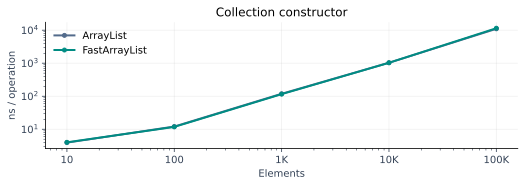

| Elements | JDK ns/op ± error | FastArrayList ns/op ± error | Speedup |
|---:|---:|---:|---:|
| 10 | 3.957 ± 0.043 | 4.036 ± 0.031 | 0.98× |
| 100 | 12.115 ± 0.574 | 11.835 ± 0.138 | 1.02× |
| 1,000 | 118.984 ± 2.685 | 116.035 ± 0.671 | 1.03× |
| 10,000 | 1,035.037 ± 10.434 | 1,032.800 ± 12.342 | 1.00× |
| 100,000 | 11,016.959 ± 592.139 | 11,464.594 ± 160.739 | 0.96× |

## Bulk add: array

Direct insertion avoids a temporary source array.

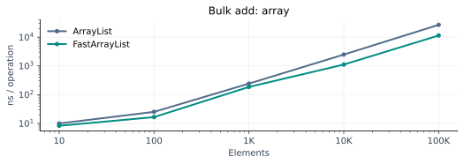

| Elements | JDK ns/op ± error | FastArrayList ns/op ± error | Speedup |
|---:|---:|---:|---:|
| 10 | 9.978 ± 0.041 | 8.295 ± 0.071 | 1.20× |
| 100 | 25.259 ± 0.097 | 16.596 ± 0.062 | 1.52× |
| 1,000 | 242.504 ± 2.947 | 185.699 ± 1.314 | 1.31× |
| 10,000 | 2,479.056 ± 26.936 | 1,113.984 ± 20.460 | 2.23× |
| 100,000 | 26,775.096 ± 247.764 | 11,414.695 ± 271.416 | 2.35× |

## Bulk add: same type

Exact-class FastArrayList insertion avoids a temporary source array.

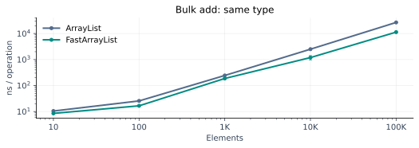

| Elements | JDK ns/op ± error | FastArrayList ns/op ± error | Speedup |
|---:|---:|---:|---:|
| 10 | 10.484 ± 0.072 | 8.502 ± 0.160 | 1.23× |
| 100 | 25.639 ± 0.430 | 16.620 ± 0.147 | 1.54× |
| 1,000 | 244.144 ± 2.032 | 187.165 ± 2.271 | 1.30× |
| 10,000 | 2,504.821 ± 30.654 | 1,191.625 ± 236.858 | 2.10× |
| 100,000 | 26,762.009 ± 302.505 | 11,346.213 ± 286.522 | 2.36× |

## Bulk add: array view

Both implementations use toArray() for the pre-existing collection view.

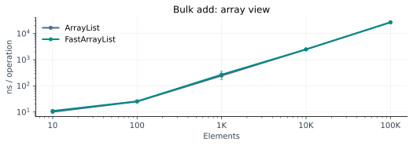

| Elements | JDK ns/op ± error | FastArrayList ns/op ± error | Speedup |
|---:|---:|---:|---:|
| 10 | 10.127 ± 0.182 | 11.015 ± 0.087 | 0.92× |
| 100 | 25.082 ± 0.495 | 25.681 ± 0.124 | 0.98× |
| 1,000 | 244.025 ± 5.918 | 268.568 ± 95.993 | 0.91× |
| 10,000 | 2,471.374 ± 22.681 | 2,478.137 ± 29.980 | 1.00× |
| 100,000 | 26,956.367 ± 572.139 | 26,749.827 ± 156.110 | 1.01× |

## Append: preallocated

Both allocate essentially the same amount; FastArrayList is 29.6% slower at 100K.

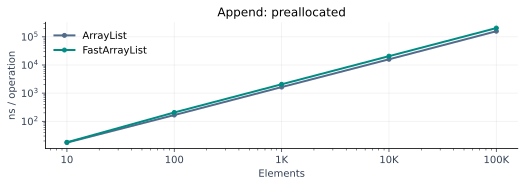

| Elements | JDK ns/op ± error | FastArrayList ns/op ± error | Speedup |
|---:|---:|---:|---:|
| 10 | 17.570 ± 0.253 | 17.990 ± 0.140 | 0.98× |
| 100 | 166.697 ± 1.244 | 206.200 ± 0.353 | 0.81× |
| 1,000 | 1,639.477 ± 31.999 | 2,064.087 ± 6.260 | 0.79× |
| 10,000 | 15,912.469 ± 175.845 | 20,554.221 ± 107.953 | 0.77× |
| 100,000 | 157,824.367 ± 2,674.568 | 204,566.567 ± 385.785 | 0.77× |

## Append: growth

FastArrayList is 28.7% slower at 100K; both complete loops are O(n).

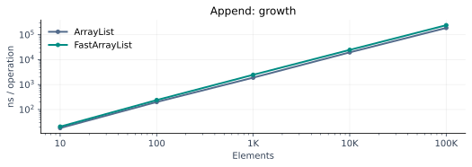

| Elements | JDK ns/op ± error | FastArrayList ns/op ± error | Speedup |
|---:|---:|---:|---:|
| 10 | 18.014 ± 0.212 | 20.572 ± 0.196 | 0.88× |
| 100 | 200.301 ± 1.193 | 239.069 ± 1.211 | 0.84× |
| 1,000 | 1,897.010 ± 10.402 | 2,469.774 ± 13.688 | 0.77× |
| 10,000 | 19,641.355 ± 95.763 | 24,681.981 ± 27.711 | 0.80× |
| 100,000 | 187,530.536 ± 1,721.927 | 241,344.722 ± 774.567 | 0.78× |

## Indexed traversal

Measures a full indexed traversal, not one random access.

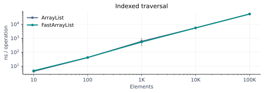

| Elements | JDK ns/op ± error | FastArrayList ns/op ± error | Speedup |
|---:|---:|---:|---:|
| 10 | 4.221 ± 0.008 | 4.689 ± 0.009 | 0.90× |
| 100 | 41.062 ± 0.064 | 41.740 ± 0.069 | 0.98× |
| 1,000 | 602.823 ± 307.997 | 531.891 ± 0.125 | 1.13× |
| 10,000 | 5,494.292 ± 14.855 | 5,452.521 ± 4.307 | 1.01× |
| 100,000 | 54,268.364 ± 32.791 | 54,262.427 ± 20.881 | 1.00× |

## Iterator traversal

Near-zero allocation is consistent with escape analysis, but does not prove it.

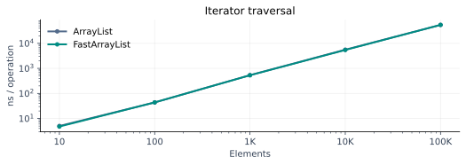

| Elements | JDK ns/op ± error | FastArrayList ns/op ± error | Speedup |
|---:|---:|---:|---:|
| 10 | 5.053 ± 0.048 | 4.781 ± 0.038 | 1.06× |
| 100 | 43.859 ± 0.056 | 43.980 ± 0.101 | 1.00× |
| 1,000 | 536.535 ± 9.502 | 532.449 ± 1.087 | 1.01× |
| 10,000 | 5,578.708 ± 29.143 | 5,435.550 ± 3.983 | 1.03× |
| 100,000 | 54,350.319 ± 66.155 | 54,477.304 ± 60.729 | 1.00× |

## Zero-copy wrap

Both allocate 24 B/op and have size-independent latency. Arrays.asList is fixed-size; FastArrayList.wrap permits structural changes and may detach from the original array.

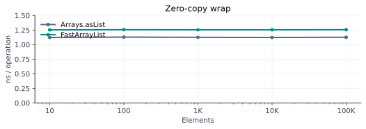

| Elements | JDK ns/op ± error | FastArrayList ns/op ± error | Speedup |
|---:|---:|---:|---:|
| 10 | 1.123 ± 0.006 | 1.253 ± 0.003 | 0.90× |
| 100 | 1.129 ± 0.008 | 1.256 ± 0.005 | 0.90× |
| 1,000 | 1.125 ± 0.006 | 1.254 ± 0.002 | 0.90× |
| 10,000 | 1.123 ± 0.008 | 1.254 ± 0.006 | 0.90× |
| 100,000 | 1.126 ± 0.011 | 1.256 ± 0.007 | 0.90× |

## Allocation profile

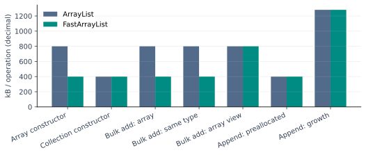

| Operation | JDK B/op | FastArrayList B/op |
|---|---:|---:|
| Array constructor | 800,056.186 | 400,040.079 |
| Collection constructor | 400,040.076 | 400,040.079 |
| Bulk add: array | 800,056.185 | 400,040.079 |
| Bulk add: same type | 800,056.185 | 400,040.078 |
| Bulk add: array view | 800,056.186 | 800,056.185 |
| Append: preallocated | 400,041.087 | 400,041.415 |
| Append: growth | 1,280,953.291 | 1,280,953.668 |
| Indexed traversal | 0.373 | 0.373 |
| Iterator traversal | 0.374 | 0.375 |
| Zero-copy wrap | 24.000 | 24.000 |

Normalized bytes per operation are the clearest allocation measure; GC counts, time and allocation rate are run-dependent. Direct array paths save roughly 400,016 bytes per operation at 100K.

## Append optimization experiments

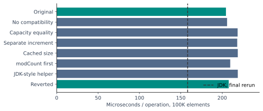

| Variant | ns/op at 100K | vs original |
|---|---:|---:|
| Original | 204,566.567 | +0.0% |
| No compatibility check | 205,932.046 | +0.7% |
| Capacity equality (clean rerun) | 218,682.149 | +6.9% |
| Cached size | 218,880.865 | +7.0% |
| modCount first | 209,736.023 | +2.5% |
| JDK-style helper | 218,886.925 | +7.0% |
| Reverted | 207,941.241 | +1.6% |

None of the six experiments improved the original. The final reverted run measured 207,941.241 ns/op versus JDK 158,287.666 ns/op (31.4% slower). The original implementation remains the baseline.

```java
@Override
public boolean add(final E element) {
    ensureCapacityFor(1);
    ensureCompatibleStorage(element);
    elements[size] = element;
    ++size;
    ++modCount;
    return true;
}
```

## HotSpot findings

JDK ArrayList.add (25 bytes) and its helper (23 bytes) were initially inlined. FastArrayList.add (39 bytes) and ensureCompatibleStorage (36 bytes) were initially rejected as too large, then inlined when hot. Capacity helpers (27 and 16 bytes) and storage checks (8 and 15 bytes) also inlined. Persistent lack of hot-path inlining is therefore not a sufficient explanation. Diagnostic timings were extremely noisy and excluded; no assembly analysis was performed.

## Follow-up: append performance and HotSpot compilation (16 November 2026)

Additional JMH runs investigated the gap between `java.util.ArrayList` and
`FastArrayList` for **100,000 preallocated calls to `add(E)` per benchmark
operation**. A test-only `org.morphix.benchmark.JDKArrayList` was compiled from
JDK `ArrayList` source to separate implementation differences from runtime
compilation effects. Inspection with `javap -c -p` showed matching bytecode
instructions and offsets for `add(E)` and its private `add` helper; the
differences were constant-pool indices, not different instructions.

### Compilation-configuration comparison

All values are JMH average time in **ns/op**, with the reported error and
`Cnt = 3`. Lower is better. Each operation performs 100,000 appends; these
figures are **not** nanoseconds per individual append.

| Configuration | JDK `ArrayList` | Locally compiled `JDKArrayList` | `FastArrayList` |
|---|---:|---:|---:|
| Default tiered compilation | 155,673.415 ± 16,934.023 | 225,493.167 ± 3,642.223 | 216,447.535 ± 4,712.080 |
| `-XX:-TieredCompilation` | 226,010.738 ± 17,949.781 | 226,445.686 ± 23,373.545 | 216,600.168 ± 10,631.149 |
| `-XX:TieredStopAtLevel=1` | 250,433.579 ± 4,157.949 | 243,967.505 ± 5,279.206 | 217,148.849 ± 5,002.846 |

The default-tiered results were reproduced in another run:

| Implementation | Earlier default-tiered run (ns/op) | Follow-up (ns/op) |
|---|---:|---:|
| JDK `ArrayList` | 155,560 | 155,673 |
| Locally compiled `JDKArrayList` | 227,246 | 225,493 |
| `FastArrayList` | 215,840 | 216,448 |

Under default tiered compilation, JDK `ArrayList` was about **45% faster in
throughput-equivalent terms** than the locally compiled copy (the copy took
**44.9% more time** per operation). With tiered compilation disabled, the two
implementations were effectively tied in these measurements. Under C1-only
compilation, their timings were also broadly comparable; `FastArrayList` was
the fastest of the three in that configuration.

`-XX:-TieredCompilation` does **not** disable JIT compilation: it normally
uses a non-tiered C2 strategy on a server VM. `-XX:TieredStopAtLevel=1`
restricts tiered compilation to C1. Taken together, these observations
associate the large JDK `ArrayList` advantage with the normal tiered
compilation/profile collection path. They do **not** identify the exact
optimization or establish that `ArrayList.add` has a dedicated intrinsic.

### `transient` field experiment

Marking the `FastArrayList` backing-array field `transient` did not produce a
meaningful change in the default-configuration preallocated-append result:

| Implementation | JMH ns/op ± error (`Cnt = 3`) |
|---|---:|
| JDK `ArrayList` | 158,838.521 ± 8,883.356 |
| `FastArrayList`, `transient` elements | 216,524.346 ± 209.466 |

`transient` controls Java serialization, not ordinary field reads or writes.
Implementing `Cloneable` or `Serializable` is likewise not a supported
performance optimization for append; those are marker interfaces.

### Interpretation and limitations

The copied-JDK comparison controls for the instructions in `add(E)` and its
helper, but **not** for call-site behavior, class-specific profiling, inlining,
or the generated machine code of the enclosing benchmark loop. The
compilation-configuration runs have only three reported measurements each,
with sizable errors in several cases. The findings are therefore evidence of
a compilation-sensitive benchmark gap, not proof of a particular HotSpot
mechanism. The results do not alter the bulk-operation advantages documented
above or imply that `FastArrayList` universally outperforms JDK `ArrayList`.
No further JVM investigation was performed.

## Next benchmark: indexed bulk insertion

Construct a destination of size n, reserve capacity 2n, insert n/2 elements from source offset n/4 at destination index n/2. Compare `ArrayList.addAll(index, arrayView.subList(offset, offset + length))` with `FastArrayList.addAll(index, array, offset, length)`. Both shift the same tail; FastArrayList can avoid the temporary source array. Destination construction and capacity allocation are included. No indexed `insert`, `removeIf`, `removeAll`, `retainAll` or `forEach` results are available yet.

## Reproducibility and limitations

Use `mvn clean test-compile` to avoid stale bytecode. Record JDK version, VM flags, GC, hardware, OS and commit hash in future runs. These are not fully recorded in the supplied baseline. Results apply to tested workloads, not all JVMs or collection types. Charts use log-scale latency axes with error bars clipped to positive values where necessary.

## Source data

[Original benchmark dataset (CSV)](morphix-benchmarks.csv) — 480 records, including timing, reported errors and GC metrics. Source: original user-supplied JMH table (`fatsarraylist-benchmark-results-001.txt`) and subsequent append experiment outputs and PrintInlining log. No new benchmarks were executed.
